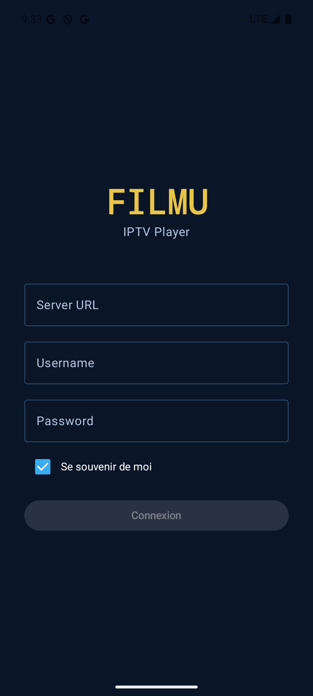
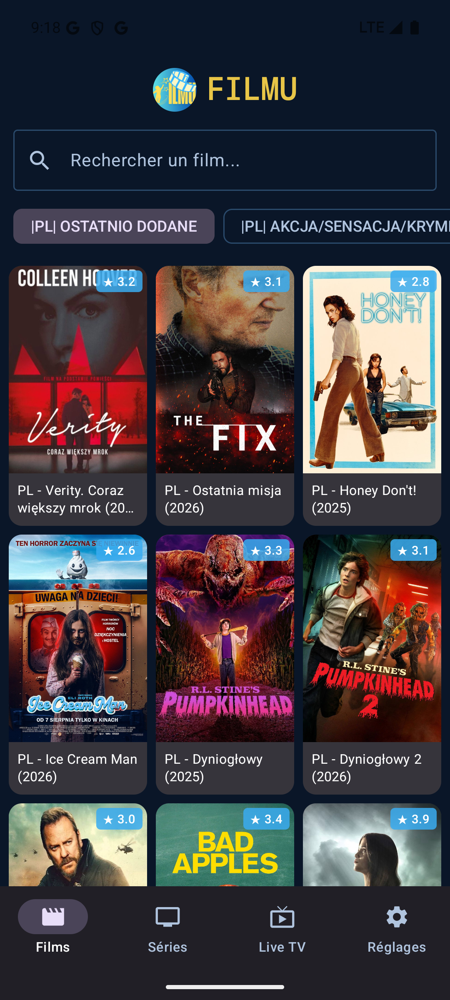
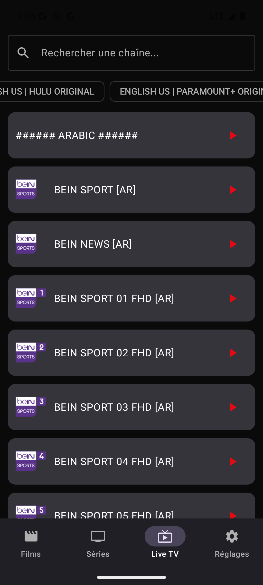

# Filmu - IPTV Player

Android IPTV player app built with Kotlin Multiplatform. Connect to any Xtream Codes server with your credentials.

## Screenshots

| Login | Home | Live TV |
|-------|------|---------|
|  |  |  |

## Features

- Connect to any Xtream Codes compatible IPTV server
- Browse Films, Series, and Live TV channels
- Per-tab search with debounce across all categories
- Category filtering with horizontal chips
- Movie/series poster grid with ratings
- Live channel list with channel icons
- ExoPlayer (Media3) for HLS streaming
- Remember me / auto-login
- Adult content filter toggle

## Tech Stack

- **Kotlin Multiplatform** (shared logic + Android app)
- **Jetpack Compose** + Material 3
- **Ktor** HTTP client
- **ExoPlayer (Media3)** for video playback
- **Coil** for async image loading

## Build

```bash
./gradlew :androidApp:assembleDebug
```

APK output: `androidApp/build/outputs/apk/debug/androidApp-debug.apk`

## Download

Get the latest APK from [Releases](https://github.com/IdrissaMaiga/Filmu/releases).
